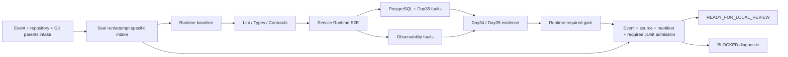

# Day35 Workflow Hardening

The independent Day35 workflow keeps `contents: read`, SHA-pinned third-party actions, no persisted checkout credentials, no inherited secrets/environment and no OIDC write capability. It validates branch CI readiness; release authority remains false. IaC remains a separate required check on the same candidate. Protected merge still requires independent review; trusted-main promotion is a separate control-plane step.



## Enforced controls

- Separate Day35 concurrency group with `cancel-in-progress: false`; active acceptance is allowed to finish. GitHub may replace pending requests, and explicit cancellation/timeouts remain possible. Historical successes never authorize a later release request.
- Intake recomputes the existing event-bound selector before expensive Runtime work. PR merge parents, repository, main push, merge queue and authorized manual-main semantics use the same existing policy. Runtime and final intake records must exactly match the final selector, including Run ID/Attempt and selector-source hash.
- Intake and final result artifacts contain Run ID/Attempt in their names. A partial failed-job rerun cannot reuse an earlier attempt's intake: use a full workflow rerun. Artifact names are routing, not authorization; both manifests and report identities are checked.
- Final admission is a separately tested module rather than an inline YAML program. It verifies both sealed bundles, source fingerprints, required proof sets, strict authorization booleans, current freshness and exactly the mandatory two fault cases without failure/error/skip/duplicates.
- Inputs reject linked/junction roots, nested or unsafe members, duplicate JSON keys, nonfinite values and oversized data (128 members, 30 MB total, 3 MB per JSON). Proof paths are fixed allowlists. Runtime acceptance and prior Day34 receipt/quality hashes are verified; quality execution and raw-log verification remain enforced by the successful reusable Runtime chain.
- Final result is written outside the inputs, using exclusive creation; a prior decision cannot be overwritten. Upstream failure/cancel/skip, missing transport or invalid evidence returns a nonzero exit and a structured BLOCKED result whenever the verifier can run. Diagnostic upload uses `always()` without changing the failed job conclusion. Runner loss/failed checkout cannot guarantee an artifact and never qualifies as success.
- The shared source digest includes the entry YAML, admission module and tests. Final result binds both manifest hashes, current event selector, source fingerprint and fault-proof hashes.

## Authority boundary

A same-run artifact/manifest proves integrity within that execution. A PR author can change branch CI code; independent protected-main verification/review remains essential for production authorization. This workflow does not establish live GitHub latest-PR identity after its event, independent approval, real AWS permission enforcement or physical ECU boot. The existing read-only cross-workflow inspector checks latest Run/Attempt and current PR identity separately. All results keep release/AWS/physical verification false.

## Verification

```powershell
python -m pytest tests/unit/test_day35_workflow_gate.py tests/unit/test_day35_evidence.py -q
python -m mypy .
python -m ruff check .
python -m ruff format --check .
```

The gate fixtures are controlled unit inputs, never substitute integration acceptance. The reusable workflow continues to run actual PostgreSQL and local simulated-boot fault tests. Run-specific results and artifact audit belong under `.runtime-reports/`; this document is not a PASS receipt.
