# Day36 — local staging deployment and rollback

This stage verifies service containers, real PostgreSQL runtime grants, HTTP
smoke requests and image rollback in an isolated local environment. It neither
deploys OTA to a physical ECU nor grants AWS or production release authority.
An unmerged branch can run these exercises; it cannot establish trusted-main
approval. Independent review and protected merge remain outstanding.

```mermaid
flowchart LR
  A[Read-only latest Runtime and IaC audit] --> B[Exact tested candidate]
  B --> C[Build historical application image]
  B --> D[Build candidate image]
  C --> E[Isolated PostgreSQL / Redis / LocalStack]
  D --> E
  E --> F[Bootstrap and migration identity]
  F --> G[Application role and startup security checks]
  G --> H[Stable loopback ingress / business smoke]
  H --> I[Startup exit / readiness 503 / SIGKILL]
  I --> J[Old image / identical idempotency key]
  J --> K[Data hashes and migration head unchanged]
  K --> L[Latest CI recheck / sealed evidence]
  L --> M[Independent recomputation / staging review]
```



## Run locally

Use the project Python 3.12 environment and Docker Desktop Linux containers.
No production credentials, local `.env`, Docker socket or host source tree is
mounted into API containers. The Docker build context is an allowlist. The
runtime uses UID/GID 10001, a read-only filesystem, dropped capabilities and
no-new-privileges. Only loopback random ports are exposed.

```powershell
$reports = '.runtime-reports/day36/local'
python -m scripts.day36_build `
  --baseline aefebb352c359e593a6b0fe572a0e8ca9dbcf97e `
  --output "$reports/images.json"
$env:DAY36_REPORT_DIR = $reports
python -m pytest tests/integration/day36 -q -o junit_family=xunit1 `
  --junitxml="$reports/staging.xml"
python -m scripts.day36_evidence --folder $reports `
  --output "$reports/day36-staging-acceptance.json"
```

Output files are exclusive: use a new report directory for each execution.
The baseline must be a full ancestor commit. Its application inputs are read
from Git archive and packaged with the new Dockerfile. This is the historical
application rebuilt with today's packaging, not a previously released binary.
The candidate must have committed application build inputs. Unrelated user
edits are preserved. If application contents match across revisions, the test
proves container deployment/restart compatibility, not a business-code upgrade
or arbitrary schema compatibility.

`image_digest` denotes the actual local Docker engine image SHA-256 ID;
it is not claimed to be a registry manifest digest. Containers run by that
immutable ID, never by a mutable tag. Python base image, PostgreSQL, Redis and
LocalStack are pinned by digest. Resolved Python dependencies are recorded by
the hash of the image's actual `pip freeze`. Full transitive dependency locking
and registry signing/SBOM are future work, not claimed by this stage.

## Fault and rollback boundaries

The runner owns a loopback-only test ingress with a stable URL. No write is
automatically retried by that proxy. A startup failure cannot replace the old
backend. The candidate is disconnected from its isolated Docker network to
force a real database readiness 503, measured inside the container. Traffic
returns to the old image. A later SIGKILL follows an accepted candidate request;
the old image is recreated and receives the same operation through the same
ingress. PostgreSQL must retain exactly one command and one outbox event.

The authenticated business smoke exercises command creation/replay plus an OTA
Campaign query. It does not perform a complete OTA installation; Day35 retains
that fault coverage. Redis is deployed as a dependency, but the API readiness
route currently probes PostgreSQL only. No separate Dispatcher is deployed.

Before recreating the old image, a changed migration head blocks rollback.
The exercise compares tenant-scoped row hashes for vehicles, remote commands,
outbox and OTA jobs. This is a bounded no-schema-change rollback drill, not a
general backwards-compatibility proof. No downgrade or production State change
is performed. Only this randomly named disposable Compose project's volumes
and containers are removed in cleanup. Host interruption can leave these local
resources behind; do not delete other projects to clean them up.

## Workflow and proof

`Day36 local staging deployment and rollback` is manually dispatched on the
current PR head branch after its primary Runtime and IaC workflows succeed.
Before this workflow is installed on main, adding the `day36-staging` PR label
provides an explicit local-test entry. Other labels do not run this chain.
The intake reuses the existing GitHub CI-fact auditor to reject
old/cancelled attempts and validate jobs, artifacts and source identity. Its
mode explicitly remains `branch-local-staging-precheck`. Test/build jobs check
out the tested PR merge SHA, which is distinct from the dispatch head SHA.
Tokens are provided only to read-only audit steps, never build/API containers.

GitHub redacts Ruleset `bypass_actors` when the caller cannot write the ruleset
([API documentation](https://docs.github.com/en/rest/repos/rules?apiVersion=2022-11-28)).
The first Day36 run exposed this API limitation and failed before deployment.
Day36 records `governance_observation.status=UNOBSERVABLE` when this field is
redacted, while still rejecting visible weakening of branch/review/check rules.
It never substitutes an empty bypass list or verifies independent approval.
CI facts and local-container exercises can be inspected with a read-only token;
the existing Day31 trusted `live` entry still rejects incomplete governance.
No token permissions or repository protection were expanded or weakened.

Five mandatory real-container JUnit cases bind to candidate, workflow Run,
Attempt and raw observation hash. The verifier rejects missing/duplicate,
failed/skipped tests, stale evidence, changed images, data differences and
non-boolean safety fields. After staging, the API auditor checks the same latest
CI identities again. Reports are sealed and uploaded under the current Run and
Attempt, then recomputed in a fresh job. Rerun the entire workflow after a failed
attempt; old intake artifacts cannot authorize a new attempt.

Local proof yields `LOCAL_STAGING_VERIFIED`; the CI-bound chain can yield
`READY_FOR_STAGING_REVIEW`. Both retain production/release authorization false.
Protected-main promotion, reviewer approval, real AWS staging, ECR/OIDC,
production ingress, database migration rollback and physical ECU boot remain
separate acceptance requirements.
