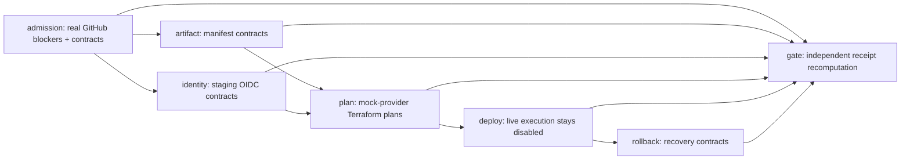

# Day37 — AWS staging governance: offline contracts, live execution disabled

This is the preparation layer, not an AWS deployment. Production's existing
`ota-aws-deploy.yml` is unchanged and stays dry-run only.



The seven-job workflow has read-only tokens, no `id-token: write`, no AWS
credentials action, no ECR push, no Terraform Apply and no ECS write command.
An explicit `day37-contracts` PR label can run it before installation on main.
Each phase runs mandatory rejection cases bound to source, Commit, Run and
Attempt. Gate recomputes receipts from actual JUnit and a sanitized Terraform
summary. Raw plans, State, unfiltered logs and credential values are not uploaded.

`offline_contracts_verified=true` means tests passed, not cloud readiness.
Overall `BLOCKED` is retained because Day36's new supply gate has real CVEs,
protected merge/review is incomplete, and signed registry artifacts plus a real
State-backed AWS plan do not exist. No path emits `AWS_STAGING_VERIFIED` or grants
execution. Pure `contract_errors` fixtures do not authenticate OIDC, verify
Cosign cryptography, query ECR or prove an actual ECS rollback.

## Terraform blueprint

`modules/ota-staging` defines immutable KMS-encrypted ECR, a non-root/read-only
Fargate task referencing `repository@sha256:<manifest>`, private networking,
internal TLS ALB/access logging, encrypted one-year CloudWatch logs, readiness,
deployment circuit breaker and a 5xx deployment alarm. Execution and application
roles are separate; only the application role can retrieve its exact DB Secret
and decrypt through Secrets Manager with the matching Secret ARN context.
Bootstrap/migration credentials never enter the ECS task.

Staging OIDC trust binds the repository, `sts.amazonaws.com` audience and
`aws-staging` Environment. Its initial policy is read-only ECR/ECS inspection:
no push, deploy, PassRole or database Secret access. Actual STS federation has
not been executed.

The module is included in the exhaustive IaC catalog. The separate
`environments/ota-staging/*.tf.example` root remains dormant: the existing gate
rejects active AWS resource roots without a State-backed read-only AWS plan.
That safety check was not weakened. Mock-provider plans are not real AWS plans.

Inputs reference existing private networking, DB/cache grants, AWS interface
endpoints/S3 gateway, private HTTPS JWKS egress, ACM, KMS policies and a protected
ALB log bucket. These dependencies are not created or verified live here.
The first deployment has no completed old service to roll back to; such an
outcome must remain blocked. Canary and workload-specific SLO calibration,
schema compatibility and cloud fault injection still require validation.

## Offline commands

```powershell
python -m pytest tests/unit/test_day37_release.py -q
terraform -chdir=infra/terraform/modules/ota-staging init -backend=false -lockfile=readonly -input=false
terraform -chdir=infra/terraform/modules/ota-staging validate
terraform -chdir=infra/terraform/modules/ota-staging test
```

Before cloud readiness: pass Day36 same-candidate supply admission; obtain real
independent review and protected merge; verify OCI/ECR manifest, Cosign and
provenance; configure the exact staging account/role/environment, budget and
cleanup policy; validate real OIDC/STS and State-backed AWS plans; review
delivery permissions and database compatibility. Only subsequent explicitly
authorized AWS execution can prove actual deployment/rollback consistency.
ECS rollback must never reset confirmed physical ECU state/security versions.
