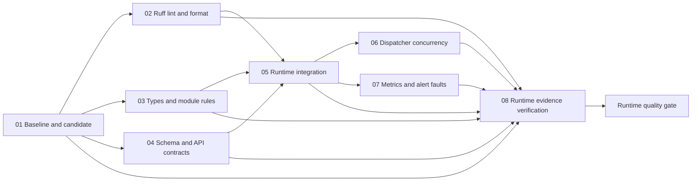
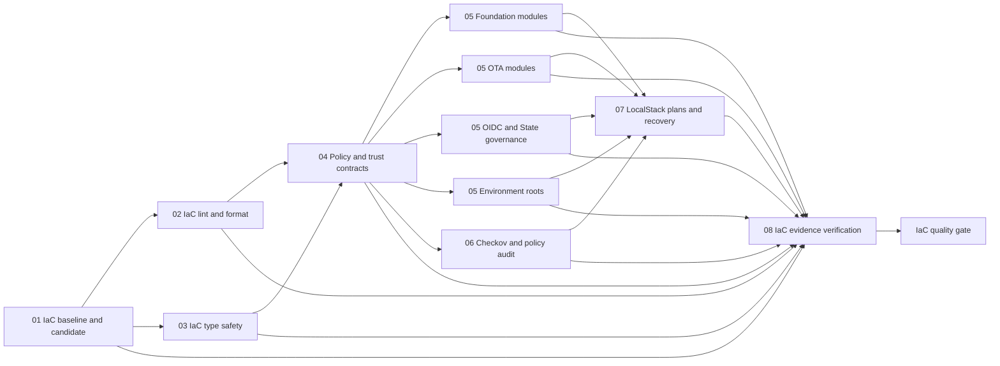

# Multi-file CI/CD presentation and execution graph

Runtime shows nine real jobs; IaC shows twelve, with four parallel module groups. Fan-out quality
checks converge on integration work, then a dedicated Evidence job and the
existing required quality gate. Expand a reusable job to inspect its engine steps.
There are no sleeps, duplicate test loops or placeholder deployment jobs added to
inflate duration. Extra setup, isolated environments, native tests and verified
artifact handoffs are actual work. Runner/network variability still affects time.

## Runtime graph

Core regression keeps the existing unit, contract, independent-process E2E,
Day12/16–19, permissions, Redis and queue-worker tests. It retains the original
PostgreSQL/Redis/LocalStack service definitions and bootstrap/migration identities.
Day21 and Day24 now execute on separate runners with their existing disposable
PostgreSQL fixtures; their database contents are never transported between jobs.
The consumer rechecks all earlier evidence plus Day24 after transport, then emits
the established `day31-runtime-trust` interface only at the final required gate.

## IaC graph

The native runner supports explicit `contracts`, `security`, `native` and legacy
`all` modes. Contracts run official-provider initialization, validation, HCL tests
and governance schema checks. Security audits both source and disposable fixture
with Checkov and expiring exceptions. Native initializes fresh provider/module
state and performs the existing isolated LocalStack plans, emulator-only Apply,
repeat plan, lock/failure/recovery and Day27–31 fault scenarios. No provider cache,
raw Terraform State, binary Plan or credentials travel in artifacts.

Native-only summaries cannot claim contracts/scanning succeeded. The Evidence
consumer requires independently identified reports from all seven producer stages (four module groups, policy, security and native),
combines real contract counts and audited scan results, then verifies Day25–31.
The final `iac-gate-summary` and existing day-specific artifacts are preserved.

## Files to show in a demonstration

| File | Responsibility |
|---|---|
| `.github/workflows/runtime.yml` | Nine-node Runtime DAG and mandatory gate |
| `.github/workflows/ci.yml` | Twelve-job IaC DAG with four module groups and mandatory gate |
| `.github/workflows/runtime-core.yml` | Service-backed Runtime regression engine |
| `.github/workflows/runtime-postgres.yml` | Fixed Day21/Day24 PostgreSQL suites |
| `.github/workflows/iac-phase.yml` | Fixed contracts/security/native Terraform phases |
| `.github/actions/setup-ci-runtime/action.yml` | Pinned Python/application test toolchain |
| `.github/actions/setup-ci-iac/action.yml` | Pinned IaC tools and optional pinned Terraform |
| `scripts/iac/pipeline_evidence.py` | Cross-job manifests, conflict detection and fail-closed completion |
| `tests/unit/iac/test_workflow.py` | Graph reachability, required stages, pinned actions and permission contracts |
| `tests/unit/iac/test_pipeline_evidence.py` | Failure/cancel/skip, replay, tampering and phase impersonation refusals |

Relative reusable workflows use the caller's commit/context; see GitHub's
[reusable workflow reference](https://docs.github.com/en/actions/reference/workflows-and-actions/reusing-workflow-configurations).
Each called workflow sets its own needed environment values. Inputs go through
environment variables and fixed enum validation, never raw shell interpolation.

## Evidence and security

Every transport bundle has one flat JSON manifest, fixed stage name, caller
Commit/Run/Attempt/source digest and a SHA-256 inventory of JSON/XML reports.
Consumers reject missing/extra files, executable files, modified bytes, another
stage/Attempt/source, and conflicting reports. They parse data only.

Use **Re-run all jobs** when repeating a complete demonstration. Rerunning only a
failed consumer cannot authorize reuse of producer bundles from an earlier Run
Attempt; such mixed-attempt input is intentionally rejected. Never relabel an old
manifest or copy provider/State directories to make a partial rerun pass.

The Evidence jobs use `if: always()` and explicitly inspect every preceding job's
result from `toJSON(needs)`. The final gates also run unconditionally and require
Evidence success plus its validated bundle. Failure, cancellation, skip or absent
result cannot become a green required check. Job summaries show actual node
outcomes and evidence identities, improving the review/demo surface.

Required check names remain **Runtime quality gate** and **IaC quality gate**;
branch rules are unchanged. There is no production Environment, production AWS
credential acquisition, `id-token: write`, real AWS Apply, State Push or Force
Unlock. The earlier protected-main Day31 collector still requires independent
review/installation; a larger graph does not authorize a deployment or merge.

Final CI and downloaded acceptance records are stored locally under
`.runtime-reports/pipeline-dag/`. The user's separate Terraform edits and root
`1.yml`, `2.yml`, `3.yml`, `test.tf` and module lock files are not part of this change.

## Multi-module IaC execution

The contract matrix has four fixed entries and max-parallel=4, fail-fast=false.
Each uses a fresh runner, official locked providers, init -lockfile=readonly,
validate and existing Terraform tests. The exhaustive catalog in
scripts/iac/module_contracts.py assigns every one of the 17 Terraform roots exactly
once. New/removed/unlisted roots fail closed, including modules missing versions.tf.
Empty environment roots additionally undergo the existing no-resource plan check.

Each contracts-GROUP.json contains actual per-root file and successful-test counts.
Four separately sealed iac-contracts-GROUP-results bundles are required. The reducer
checks exact group/root identities, counters, completeness and common source/Run/
Attempt before summing; an omitted shard cannot be replaced by a fabricated total.
Native LocalStack work starts only after all module groups and Checkov succeed.
The original IaC quality gate name and Day25-31 artifact interfaces are retained.
Real AWS Apply, State push and force-unlock remain disabled.
