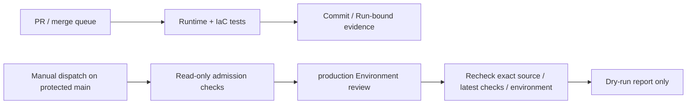

# Day25 — OTA production deployment governance (disabled-by-default skeleton)

## What is delivered

CI and deployment admission are separate. PR checks still validate Terraform,
contracts, plan policy, provider integrity and isolated LocalStack idempotency.
They cannot request a GitHub OIDC token or consume production credentials.

The new `ota-aws-deploy.yml` accepts manual dispatch only. Both jobs have only
`contents: read` and `actions: read`; neither has `id-token: write`. There is no AWS
credentials action, long-lived key, production Terraform command or Apply switch.
The only selectable mode is `dry-run`, and the admission code independently
rejects every other mode, even if a caller supplies an `approved=true` flag.



The protected job rechecks admission after approval. It checks the exact current
main SHA, protected-branch flag, repository, dispatch event and requested mode;
reads the live Environment and exact branch-type rule; and requires successful
latest Runtime/IaC workflow runs for that same main SHA. Workflow paths, source
repository, branch, status and execution timestamps are checked. A later failed or
pending rerun cannot fall back to an older success. Inputs pass through quoted
environment variables, not interpolated shell source. Checkout always uses the
immutable workflow SHA, never an arbitrary release input.

Global/job execution environments, alternate runners, unreviewed actions/commands,
conditional admission, soft failure and broadly scoped artifact uploads are
rejected by the static contract. The deployment preflight uses Python standard
library and GitHub CLI read APIs; it does not install or invoke an AWS SDK.

## Future AWS OIDC identity contract

`infra/terraform/modules/github-oidc-deploy/` defines a dedicated future identity,
but is deliberately not instantiated by any Terraform deployment root. It does
not create an OIDC provider. An explicit non-LocalStack AWS account and exact
artifact bucket ARNs are required; no real account has been inferred or selected.

The only trusted principal is:

```text
arn:aws:iam::<account>:oidc-provider/token.actions.githubusercontent.com
```

The role trust uses `sts:AssumeRoleWithWebIdentity` with exact `StringEquals`:

```json
{
  "token.actions.githubusercontent.com:aud": "sts.amazonaws.com",
  "token.actions.githubusercontent.com:sub": "repo:SKYBREAKERZERO/ConnectedVehicle-AIoT-Enterprise:environment:production"
}
```

An Environment subject does not itself bind a branch or workflow filename. GitHub
Environment branch rules and fresh release admission enforce those additional
boundaries. Synthetic claims tests are policy models; they do not authenticate
JWT signatures or prove a real AWS STS decision.

The identity policy and required permissions boundary allow only four metadata
reads on exact bucket ARNs, with `aws:ResourceAccount` equal to the configured
account: `s3:GetBucketLocation`, `s3:GetBucketVersioning`,
`s3:GetEncryptionConfiguration`, `s3:GetBucketPublicAccessBlock`. There is no object
read/write, Secret read, IAM mutation, `iam:PassRole`, `sts:AssumeRole` or wildcard
Allow. The boundary's implicit deny caps additional grants to the same read-only
scope. This preview identity is intentionally **not sufficient for Terraform
production Plan/Apply or remote-state access**. Role max-session duration is one
hour; a future approved OIDC session should request a shorter bounded duration.
Role and boundary deletion remain protected by `prevent_destroy`.

## Live GitHub configuration checked

The repository is public and the connected account has administration permission.
The `production` Environment was absent at audit time. It has now been created
and read back through GitHub's API with:

- Required reviewer: `SKYBREAKERZERO`, selected by the user.
- Prevent self-review: enabled.
- Administrator bypass: disabled, confirmed by API read-back.
- Exact custom deployment rule: `main`, type `branch`; no Tag or wildcard rule.
- Existing main branch protection and both strict required checks preserved.
- No production credential, AWS account setting or OIDC token configured.

Because the sole required reviewer is also the repository owner, an owner-triggered
deployment cannot be self-approved. Another authorized initiator or an independent
reviewer is needed for a later approval exercise. This deliberate block is not
reported as a completed human approval drill.

The new workflow currently lives on the PR branch. It must be reviewed and merged
before GitHub can expose it as a default-branch dispatch entry. No PR was merged
to make that exercise possible. Main quality runs for a future merged SHA must
finish successfully before its preflight can pass.

## Tests and evidence

The new governance tests cover PR/workflow-run/push admission, issuer/audience/
subject/provider-account mismatch, unprotected branches and Tags, missing reviewers,
self-review/admin bypass, arbitrary source SHA, Apply despite caller-asserted
approval, dangerous IAM writes/wildcards/cross-account scope, Destroy/replacement/
state removal, untrusted workflow actions/checkouts/execution defaults, stale
quality success after a newer failure, and missing/skipped/tampered evidence.

Native Terraform mock-provider contracts assert the exact rendered trust policy,
boundary attachment and four scoped actions, and reject wrong accounts, wildcard
or object ARNs and empty scope. Tests use `command=plan`; the module is not applied.
Security scans retain every existing policy and exception boundary.

IaC CI produces `.iac-reports/day25-security.xml` and
`.iac-reports/day25-governance.json` in the `day25-deploy-governance` artifact.
Pytest stamps commit SHA, workflow Run/attempt and governance source digest inside
JUnit at test time; the producer verifies those stamps and mandatory cases before
writing its report. Failed/skipped tests, duplicate metadata, wrong source/run or
missing security cases cannot pass. The evidence identifies `production` while
explicitly recording `production_apply_enabled=false`,
`aws_credentials_requested=false`, `aws_sts_verified=false` and
`github_approval_execution_verified=false`.

Final local read-back snapshots and CI metadata belong in ignored
`.runtime-reports/day25/`. This avoids changing the accepted commit solely to
embed its own Run ID in a tracked document. Runtime and IaC must both succeed on
the same delivered head, with each artifact bound to its own workflow Run ID.

## Acceptance boundaries and Day26 prerequisites

| Item | Day25 acceptance |
| --- | --- |
| PR/CD permission separation, no PR production entry | Static negative contracts and unchanged read-only CI permissions |
| Exact OIDC repository/environment/audience/account trust | Native plan contracts and synthetic claims only |
| Manual review and main-only Environment configuration | Live GitHub API configuration/read-back |
| Actual approved workflow execution | Not exercised; default-branch merge and independent approval still needed |
| AWS OIDC provider/Role creation and signed STS exchange | Not performed, not replaced with LocalStack |
| Production Terraform Plan/Apply | Disabled; no production plan is produced or approved |
| Source/run/environment/test evidence | Mandatory versioned CI artifacts and final read-back audit |

Day26 must first establish an AWS sandbox, budget/cleanup policy, verified provider
and account, encrypted/locked remote state, separate least-privilege Plan/Apply
roles, immutable plan digest/source binding, approval-to-Apply consistency and
real signed STS tests. Adding token minting or write permissions requires explicit
review and changes to the current deny-by-default contracts. Repository and AWS
policy administrators remain trusted control-plane actors; these checks cannot
prevent a fully privileged administrator from changing the protection system.

The user's unrelated local `ota-local/main.tf` edit is preserved and excluded from
this work. No AWS production Apply, GitHub merge or database migration is performed.

## Primary references

- [GitHub: OIDC in AWS](https://docs.github.com/en/actions/how-tos/secure-your-work/security-harden-deployments/oidc-in-aws)
- [GitHub: deployment environments and protection rules](https://docs.github.com/en/actions/reference/workflows-and-actions/deployments-and-environments)
- [GitHub: environment REST API](https://docs.github.com/en/rest/deployments/environments)
- [GitHub: branch/tag deployment policies](https://docs.github.com/en/rest/deployments/branch-policies)
