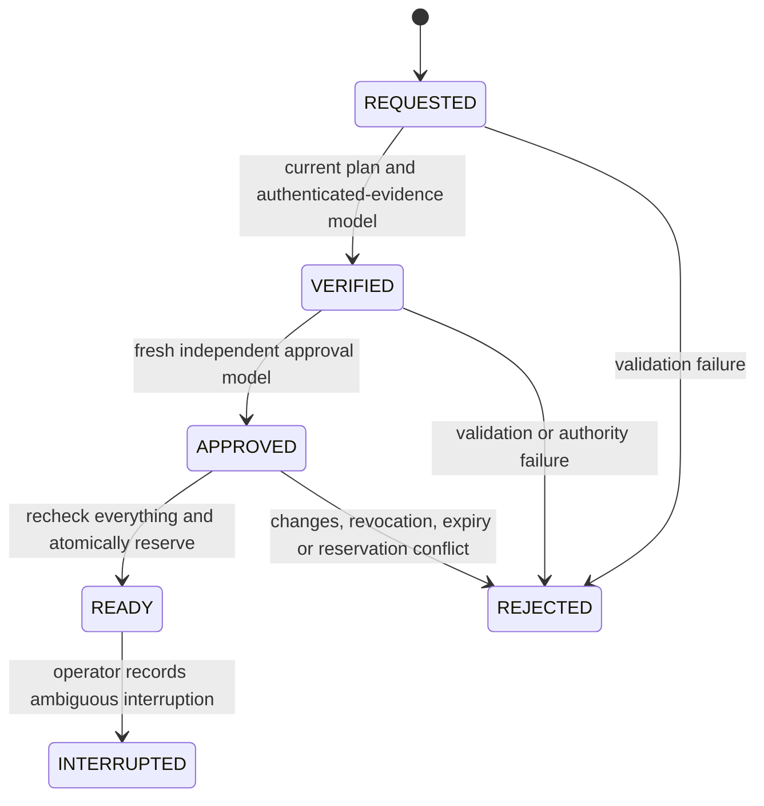

# Day27 — Release admission and interruption recovery

## Baseline and scope

Day26 was checked before starting Day27: commit
`b41230c5aaf5b873a4a68b08e226d09a5b55b395` passed both
[IaC run 40484120822](https://github.com/SKYBREAKERZERO/ConnectedVehicle-AIoT-Enterprise/actions/runs/40484120822)
and [Runtime run 40484120807](https://github.com/SKYBREAKERZERO/ConnectedVehicle-AIoT-Enterprise/actions/runs/40484120807).
Its accepted evidence distinguishes offline contracts/LocalStack from AWS, and
does not claim real AWS credentials, lock recovery, STS or approval execution.

Day27 adds a persistent **offline admission model**, conservative recovery advice
and real Terraform-process failure injection against disposable LocalStack.
It does not enable production Apply, migrate/restore/delete real state, assume
AWS roles, issue GitHub deployment approvals or merge the PR.

## Admission state machine

`scripts/iac/release_admission.py` implements:



There is no direct transition to READY, reset, unlock, delete or resume method.
REJECTED/INTERRUPTED are terminal. READY is an offline one-shot reservation,
**not AWS execution permission**. Repeating READY fails. A crash immediately after
the durable READY commit leaves it spent; reopening the process does not reset it.

Every transition compares the immutable stored request binding and current trusted
release/state context, then rechecks time bounds and provenance. Inputs are copied
before validation; trust callbacks cannot mutate the validated payload through
the dictionaries they receive. The Day26 plan/approval validation API remains
compatible; its pre-approval plan validation is now separately reusable.

| Binding | Rejection/review requirement |
| --- | --- |
| Commit, account, environment, exact execution roles | Any mismatch rejects the old request |
| Binary plan digest, Terraform version, provider lock digest | Changed plan/toolchain requires new verification |
| Bucket/key, region/KMS key, state lineage/serial | Changed state target or snapshot rejects old approval |
| Source SHA-256, repository, CI workflow, Run ID and Attempt | Old/foreign/mismatched evidence cannot be reused |
| Request ID and complete evidence/manifest binding | Another request cannot use the previous receipt/evidence |
| Independent reviewer, approval ID, approval time/expiry | Self review, changed receipt, revoked or expired approval rejects |

Evidence and approval authority callbacks are **mandatory trust adapters**. They
must return exactly `True`; false/unknown/exception rejects and persists an audit
event. Tests supply explicit simulated adapters. No JWT signature, GitHub approval
authentication, revocation service or signed artifact attestation is implemented
by these models. Arbitrary JSON or `lambda _: True` is not a production authority.
Future adapters need bounded network calls, authenticated reviewer/source/run
identity and authoritative current state/time, never values supplied by the
release author. Unavailable authority must continue to fail closed.

The local SQLite demonstration serializes compare-and-transition, audit records,
spent-plan insertion and per-backend reservation inside a transaction. Two
independent connections can approve competing requests, but only one can become
READY. Both reservations roll back together on conflict. Relabeling a request or
Run does not reset a consumed plan. Reservations stay held after interruption.

This store has no production completion or reconciliation API; it deliberately
blocks ambiguous reuse. It does not coordinate separate GitHub runners, survive
deletion of its local database, authenticate its clients or resist a filesystem/DB
administrator changing records. Its append-only event API is not cryptographic
audit storage. A central authenticated durable ledger, fenced executor, actual
approval authority and independently reviewed reconciliation workflow are still
required before production execution.

## State-lock failure injection

`tests/integration/iac/test_state_lock_contention.py` runs through the IaC Gate's
own disposable LocalStack. Missing endpoint/report configuration fails the test;
it is never silently skipped.

1. Seed a synthetic state snapshot in the isolated emulator and record its bytes.
2. Start a real `terraform plan` process using the native S3 backend with
   `use_lockfile = true`. A bounded built-in `terraform_data` graph/output pipe
   keeps the plan alive while the parent observes its native lock.
3. Start an independent contender; verify bounded lock timeout and unchanged lock.
4. Abruptly kill the holder process; verify another contender remains blocked by
   the same orphaned lock and the state bytes are unchanged.
5. Preserve the orphan lock for evidence. No `force-unlock`, `delete_object`, state
   push/restore, Apply or automatic retry occurs. Only the enclosing test-owned
   emulator container is destroyed during fixture cleanup.

No Terraform Apply is used in this new probe. Therefore it proves native lock
exclusion and interruption behavior for Plan, not successful deployment or
concurrent Apply writes. The fixture uses dummy credentials and AES256 in
LocalStack; real AWS S3/KMS/IAM, network partitions, version restore and regional
durability remain unverified. Day26's separate unwired state module retains its
SSE-KMS contracts and its separate lock-release/reacquisition probe.

Terraform's state lock protects one backend state. It is separate from the
application's one-shot release reservation. Neither replaces the other.

## Recovery policy and operator sequence

`scripts/iac/state_recovery_policy.py` only returns advice. It always refuses
automatic force-unlock, state deletion, resuming an old request and production
Apply. Any interruption, lock, live/unknown owner, changed state or stale approval
requires manual review. Even a clean observation requires a new verified request.

Before any separately authorized real recovery:

1. Freeze new release requests for the backend; preserve the interrupted Run,
   source/plan hashes, approval identity, native lock ID and execution evidence.
2. Independently establish executor termination, including any orphan subprocess,
   and reconcile the actual cloud-resource and state outcome. Lock age alone is
   not proof that its owner is dead. Unknown outcome remains blocked.
3. Preserve encrypted state/version evidence privately. Do not upload state or
   saved binary plans into ordinary artifacts and do not delete state to fix CI.
4. Obtain independent recovery review. This implementation issues no real unlock
   or restore command and grants no recovery permissions. Any future manual action
   needs exact lock/backend/version verification and a separately reviewed path.
5. Re-read current state, create a new plan, run policy checks, obtain fresh
   request-bound evidence and independent approval. Never restore a copied lock or
   reuse the old READY authorization. Production ledger reconciliation is pending.

## Workflow and evidence

`ota-aws-deploy.yml` remains workflow_dispatch/main/Environment gated, with only
read permissions, no AWS credential step, no token-minting permission and no
Terraform Apply. Preflight rechecks live review rules, Environment and exact-SHA
quality runs; the report explicitly says `release_admission_state=NOT_REQUESTED`
and disables automatic recovery. It does not manufacture READY without a plan and
authenticated authority. The workflow is still on the PR branch; no merge or live
Environment-approved dispatch is performed to demonstrate it.

IaC CI runs the full existing unit regression plus new admission/recovery negative
tests, then native Terraform contracts/scans and the isolated lock interruption
integration. After the gate it revalidates the fault XML/JSON against test-time
source, commit and Run/Attempt and produces a combined report. Failed/skipped/
missing/duplicated cases, relabeled source/run, missing proof, unsafe recovery
flags or a report falsely claiming AWS validation fail closed.

The mandatory `day27-release-recovery` artifact is retained seven days and contains:

- `day27-governance.json`: test-time provenance, required scenarios, unit XML hash,
  verified fault XML/report hashes, explicit production limitations.
- `day25-security.xml`: full IaC unit-suite results, including Days25–27 stamps.
- `day27-lock.xml` and `day27-lock.json`: actual emulator-process fault result,
  lock waits, unchanged-state digest, no-unlock/no-Apply flags and provenance.

No state contents, binary plan or credentials are uploaded. CI artifact bindings
are not independent cryptographic attestation against a malicious workflow;
reviewed source and authenticated future production authorities remain necessary.

Local commands:

```powershell
.venv/Scripts/python.exe -m ruff check .
.venv/Scripts/python.exe -m ruff format --check .
.venv/Scripts/python.exe -m mypy .
.venv/Scripts/python.exe -m pytest -c scripts/iac/pytest.ini tests/unit/iac -q --junitxml=.iac-reports/day25-security.xml
.venv/Scripts/python.exe -m scripts.iac.deploy_governance
.venv/Scripts/python.exe -m scripts.iac.day26_evidence
.venv/Scripts/python.exe -m scripts.iac.day27_evidence
```

For the opt-in integration test, use only an ephemeral loopback LocalStack with
`DAY27_LOCK_ENDPOINT` and a private `DAY27_LOCK_REPORT` path. The gate provisions
these automatically, then runs `day27_evidence --with-fault`. Do not supply a real
AWS backend or adapt the fixture to a shared development bucket.

References: [HashiCorp state recovery](https://developer.hashicorp.com/terraform/cli/state/recover),
[state locking](https://developer.hashicorp.com/terraform/language/state/locking),
[saved plan workflow](https://developer.hashicorp.com/terraform/cli/run).
