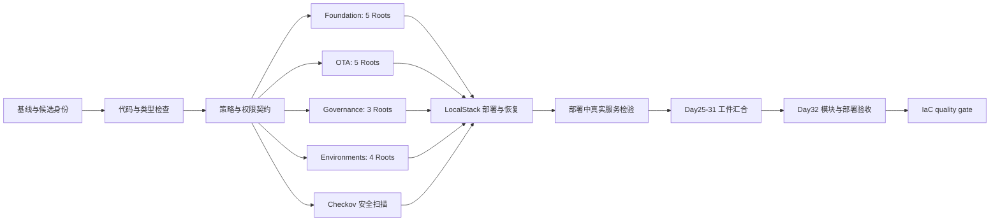

# Day32 多模块 IaC 自动化：部署、检验与证据校验

## 验收范围

这是可执行的 LocalStack IaC 工作流，继续复用 `.github/workflows/ci.yml`。
它不等同于已经完成独立审查、受保护合并及主分支 Trusted Promotion。
真实 AWS Apply 禁用。已有审批保护保持不变。

GitHub 实际执行 13 个 Job。图中部署与真实服务检验在同一个 Native Job 内完成，
避免将已销毁的 LocalStack 伪装成跨 Runner 可访问的环境。

## 多模块 CI

四组矩阵并行执行，max-parallel=4，fail-fast=false。覆盖 17 个已有 Root：
12 个 Terraform 模块、1 个 Bootstrap 和 4 个环境。每个 Root 使用官方 Provider、
只读 Lock 初始化、Validate 和既有 Terraform Contract Tests。

`module_contracts.py` 拒绝漏组、漏 Root、重复计数和伪造计数。
原有基线为 104 个 Terraform 契约；最终以本次 CI 的真实报告为准。

## 隔离部署 CD

Native Runner 创建本次独占的 LocalStack 容器、端口和临时工作区，使用测试凭据。
先执行 Plan 与 Policy，再把 Saved Plan Apply 到模拟器。部署 local 和 ota-local
两个 Root；部署后执行第二次 Plan，要求退出码为 0。继续运行 State Lock、恢复、
Quarantine 和 Day27-31 故障测试。最后删除本次容器，不触及其他 Backend。

不上传 Terraform State、二进制 Plan、Provider 目录或 Secret 值。

## 部署后真实检验

`deployment_probe.py` 只允许本次 `http://127.0.0.1:PORT` 端点：

- SQS：真实发送、接收、校验 MessageId/Body、删除本次测试消息。
- Queue：读回 ARN、KMS 配置及 DLQ 绑定，与 Terraform 输出核对。
- KMS：读回 KeyMetadata，核对 ARN 和 Enabled 状态。
- Secrets Manager：只 DescribeSecret，核对 KMS 绑定，不读取 SecretValue。
- IAM：读回应用 Role 及附加 Policy，与 Terraform 输出核对。
- OTA：既有真实隔离 Apply 后的第二次 Plan 必须无变更。

读回只证明 LocalStack API 的行为和元数据，不证明真实 AWS IAM 或加密执行。
任何超时、缺失或不匹配均使 Native Job 失败，不能生成合格部署回执。

## Day32 校验与 Artifact

Native 生成 `day32-deployment.json`。上游完整成功后，Day32 验收节点检查：

1. Commit、源码摘要、Run ID 和 Attempt 必须匹配。
2. 六项部署检验完整成功，实际资源计数为正整数。
3. 四组模块汇总完整且与原始计数一致。
4. 第二次 Plan 为 0、没有 Destroy、Checkov 通过。
5. Day31 治理证据属于同一身份，不能自称生产授权。

生成 `day32-acceptance.json`，绑定部署回执、汇总及治理文件的 SHA256。
最终门禁下载密封 Artifact 后重新计算验收结果；篡改、旧 Attempt、缺少检查、
错误环境、缺失模块、变更 Plan 及生产授权声明均拒绝。

Artifact：`day32-iac-acceptance`，保留 7 天。字段始终明确：
`scope=localstack_iac_acceptance`、`production_apply_enabled=false`、
`release_authorized=false`、`trusted_main_promotion_verified=false`、
`independent_approval_verified=false`。

## 代码入口

- `.github/workflows/ci.yml`：矩阵、依赖和 Day32 门禁。
- `.github/workflows/iac-phase.yml`：隔离 Terraform 执行引擎。
- `scripts/iac/gate.py`：Plan/Apply、二次 Plan、恢复和容器生命周期。
- `scripts/iac/deployment_probe.py`：真实服务读回。
- `scripts/iac/day32_evidence.py`：验收与重放拒绝。
- `tests/unit/iac/test_day32_evidence.py`：权限边界及证据负向回归。

独立 Reviewer 和可信主分支执行属于原 Trusted Promotion 计划的外部条件，
不由此 LocalStack 工作流生成或替代。
